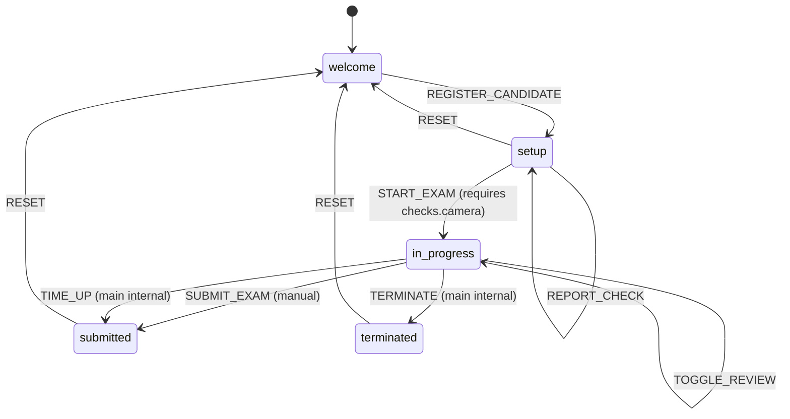

# Argus — Architecture Documentation

Argus is a secure, proctored exam desktop application designed for macOS, built as an Application Development course project.

---

## 1. Process Model

Argus follows Electron's multi-process architecture with strict isolation boundaries:

- **Main Process (`electron/main.cjs`, `electron/window.cjs`, `electron/core/`, `electron/services/`, `electron/ipc/`)**:
  - Runs in a full Node.js runtime environment with direct access to macOS system APIs, window lifecycle management, and hardware resources.
  - Acts as the **single source of truth** for all exam session data, state transitions, security rules, and wall-clock countdown timing.
- **Renderer Process (`src/`)**:
  - Runs inside a sandboxed Chromium browser window executing React 19 and standard Web APIs.
  - Purely declarative UI: renders the state broadcast from the main process and dispatches user actions as typed commands.
  - Strictly forbidden from accessing Node.js or Electron primitives directly (`nodeIntegration: false`, `sandbox: true`).
- **Preload Script (`electron/preload.cjs`)**:
  - Serves as the secure bridge between the privileged Main Process and the unprivileged Renderer Process.
  - Exposes controlled, validated APIs to the renderer via `contextBridge.exposeInMainWorld('argus', ...)`.

> **Note on `.cjs` Extension**: The root `package.json` contains `"type": "module"` to allow Vite and React components in `src/` to use ES modules (`import`/`export`). Because Electron main and preload scripts use Node.js CommonJS (`require`/`module.exports`), they are explicitly given the `.cjs` file extension.

---

## 2. Directory Structure

```
argus/
├── docs/
│   └── ARCHITECTURE.md            # Living architecture document & design decisions
├── electron/
│   ├── core/
│   │   ├── config.cjs             # Immutable exam config loader
│   │   ├── examStore.cjs          # State machine, command queue, and transitions
│   │   ├── lifecycle.cjs          # Resource scope and deterministic cleanup
│   │   └── trust.cjs              # Shared origin and URL trust verification
│   ├── data/
│   │   └── exam.config.json       # Exam parameters and proctoring thresholds
│   ├── ipc/
│   │   ├── channels.cjs           # Single source of truth for IPC channel strings
│   │   └── register.cjs           # IPC handler registration & sender validation
│   ├── services/
│   │   ├── examTimer.cjs          # Drift-free wall-clock countdown timer
│   │   └── permissions.cjs        # macOS TCC & Chromium session permission handlers
│   ├── main.cjs                   # App lifecycle, scope disposal, and entry point
│   ├── window.cjs                 # BrowserWindow configuration, security guards & push messaging
│   └── preload.cjs                # Context bridge with explicit channel allowlist
├── src/
│   ├── api.js                     # Renderer-side typed client wrapping window.argus
│   ├── components/
│   │   └── TitleBar.jsx           # Custom frameless title bar & window controls
│   ├── hooks/
│   │   ├── useCamera.js           # Webcam media stream and readiness hook
│   │   ├── useExamState.js        # Exam state subscription and dispatch hook
│   │   └── useRemainingTime.js    # Timer tick subscription hook
│   ├── screens/
│   │   ├── WelcomeScreen.jsx      # Candidate registration and input validation
│   │   ├── SetupScreen.jsx        # Pre-flight checklist & candidate verification
│   │   ├── ExamScreen.jsx         # Live exam screen with countdown timer & proctor view
│   │   └── ResultScreen.jsx       # Final submission & termination summary
│   ├── utils/
│   │   └── formatTime.js          # Millisecond-to-duration time formatter
│   ├── App.jsx                    # Phase router and persistent proctor video host
│   ├── main.jsx                   # React DOM mounting & entry point
│   └── styles/
│       └── app.css                # CSS design tokens, typography, and theme
├── public/                        # Static public assets
├── index.html                     # Application HTML shell
├── vite.config.js                 # Vite bundler, dev server & production CSP plugin
├── eslint.config.js               # ESLint flat configuration (ESM + CommonJS)
├── package.json                   # Project manifest, dependencies, and scripts
└── README.md                      # Project quickstart guide
```

---

## 3. Core Architectural Rules

Every commit in this project adheres to the following principles:

1. **CommonJS for Electron**: All Electron files reside in `electron/` and use the `.cjs` extension with CommonJS `require()`.
2. **Strict Renderer Boundary**: The renderer process (`src/`) must never import `electron`, Node built-in modules (`fs`, `path`, `child_process`), or any native modules.
3. **Controlled OS Access**: All OS access, native calls, and Electron IPC communications must flow through `window.argus` and be consumed via `src/api.js`.
4. **IPC Channel Naming Standard**: IPC channel names follow the structured `"domain:action"` format (e.g., `"app:get-info"`, `"exam:command"`, `"permissions:request-camera"`).
5. **Main Process State Retention**: Any state or session data that must survive renderer navigation or window reloads must reside in the Main Process.
6. **Deterministic Resource Cleanup**: All intervals, timeouts, and observers must be registered under a `createScope()` lifecycle container so they are destroyed deterministically upon phase changes or application quit.

---

## 4. Configuration Roadmap (`exam.config.json`)

The application parameters are defined in `electron/data/exam.config.json` and consumed across development commits:

| Config Field | Type | Consumed in | Description |
|---|---|---|---|
| `title` | `string` | Commit 3 | Exam title displayed on Welcome, Setup, and Exam screens |
| `durationMinutes` | `number` | Commit 3 | Overall exam time allocated for the wall-clock countdown |
| `shuffleQuestions` | `boolean` | Commit 5 | Randomizes question presentation order per candidate |
| `warningMinutes` | `number[]` | Commit 5 | Thresholds for low-time warning dialogs and visual alerts |
| `maxViolations` | `number` | Commit 6 | Maximum security strikes allowed before auto-termination |
| `blockedApps` | `string[]` | Commit 7 | Blacklisted process names monitored on macOS |
| `processScanIntervalSeconds`| `number` | Commit 7 | Interval frequency for background process auditing |
| `snapshotIntervalSeconds` | `number` | Commit 8 | Frequency for automated webcam candidate snapshots |

---

## 5. Exam State Machine Architecture

### 5.1 State Machine Phase Diagram



### 5.2 Command Specification Matrix

| Command | Allowed Phases | Authorized Source | Payload Schema | Description |
|---|---|---|---|---|
| `REGISTER_CANDIDATE` | `welcome` | Renderer | `{ name: string (2-60), rollNo: string (3-30 alphanumeric) }` | Saves student credentials and advances to `setup` |
| `REPORT_CHECK` | `setup`, `in_progress` | Renderer | `{ name: 'camera', ok: boolean }` | Reports hardware check status to main process |
| `START_EXAM` | `setup` | Renderer | `void` | Validates preconditions (`checks.camera`), enters `in_progress`, starts timer |
| `SAVE_ANSWER` | `in_progress` | Renderer | `{ questionId: string, optionIndex: number \| null }` | Records or clears candidate answer for a question |
| `TOGGLE_REVIEW` | `in_progress` | Renderer | `{ questionId: string }` | Flags or unflags a question for candidate review |
| `SUBMIT_EXAM` | `in_progress` | Renderer | `void` | Manually concludes assessment (`submitReason: 'manual'`) |
| `TIME_UP` | `in_progress` | Main Process (`main`) | `void` | Triggered by timer expiration (`submitReason: 'time_up'`) |
| `TERMINATE` | `in_progress` | Main Process (`main`) | `{ reason?: string }` | Halts exam on fatal security violation |
| `RESET` | `setup`, `submitted`, `terminated` | Renderer | `void` | Generates new `sessionId`, resets state, preserves candidate details |

### 5.3 Serialized Command Execution Queue
To guarantee state integrity, all commands pass through a serialized Promise queue (`this._queue = this._queue.then(...)`). Commands are executed strictly one at a time. This prevents race conditions between user clicks, async modal confirmations, and background timer ticks.

### 5.4 Drift-Free Wall-Clock Timer
Rather than decrementing a local counter every second (which suffers from CPU throttling, timer drift, and the class project's `60 * 60 * 60` bug), `examTimer.cjs` establishes an absolute wall-clock `endsAt = startedAt + durationMs`. Every 1000ms tick calculates:
$$\text{remainingMs} = \max(0, \text{endsAt} - \text{Date.now()})$$
If the window is reloaded (e.g. `Cmd+R`), the renderer immediately reconnects and displays the correct remaining time without resetting.

---

## 6. Permissions & Hardware Security Architecture

Argus enforces a strict two-layer defense-in-depth model for hardware device permissions:

### 6.1 Two-Layer Permission Architecture
1. **OS-Level Layer (macOS TCC via `systemPreferences`)**:
   - macOS manages camera access through its Transparency, Consent, and Control (TCC) subsystem.
   - `permissions.cjs` queries `systemPreferences.getMediaAccessStatus('camera')` to check if authorization is `'granted'`, `'denied'`, `'restricted'`, or `'not-determined'`.
   - If `'not-determined'`, `systemPreferences.askForMediaAccess('camera')` initiates the native macOS permission prompt.
   - If denied, `openCameraSettings()` opens `x-apple.systempreferences:com.apple.preference.security?Privacy_Camera` to guide the student to grant permission.
2. **Chromium-Level Layer (`session.setPermissionRequestHandler`)**:
   - By default, Electron grants every permission requested by web content without prompting. This default is unacceptable in an exam proctoring client.
   - `installPermissionHandlers(session.defaultSession)` intercepts all permission queries:
     - Allows **only** `permission === 'media'` when `details.mediaTypes` contains `'video'` and **not** `'audio'`, and the requesting URL is verified as trusted.
     - Denies all other requests (microphone/audio, geolocation, notifications, clipboard, midi).
     - Installs `setDevicePermissionHandler(() => false)` to categorically block WebUSB, WebHID, Web Bluetooth, and Web Serial.

### 6.2 Why Audio Permission is Denied
Argus is designed for visual proctoring and identity verification. Audio recording is deliberately denied to minimize student privacy exposure, prevent ambient audio snooping, and reduce the surveillance footprint of the application.

### 6.3 macOS Packaging Note
The native macOS permission prompt requires `NSCameraUsageDescription` to be declared in the application `Info.plist`. This plist key will be configured in the packaging specification in Commit 10.

---

## 7. IPC Contract & Security Architecture

### 7.1 Response Envelope Format
All IPC handlers invoked from the renderer return a uniform response envelope:
- **Success**: `{ ok: true, data: T }`
- **Failure**: `{ ok: false, error: { code: string, message: string } }`

### 7.2 Sender Trust Validation (`isTrustedSender`)
Every IPC invocation in `electron/ipc/register.cjs` is verified before execution:
1. `event.senderFrame` must exist and be valid.
2. `event.sender` must strictly match the main application window's `webContents`.
3. The frame URL (`event.senderFrame.url`) must match `isTrustedUrl`:
   - In development: starts with `process.env.ARGUS_DEV_URL` (`http://localhost:5173`)
   - In production: starts with `file://` (pointing to the local `dist/` directory)

Calls failing this validation are rejected immediately with error code `'FORBIDDEN'`.

### 7.3 IPC Contract Specification

| Channel | Direction | Payload | Return Value | Description |
|---|---|---|---|---|
| `app:get-info` | Renderer → Main (`invoke`) | `void` | `{ name, version, platform, isPackaged, electronVersion }` | Returns application metadata |
| `window:minimize` | Renderer → Main (`invoke`) | `void` | `null` | Minimizes the main window |
| `window:toggle-maximize` | Renderer → Main (`invoke`) | `void` | `null` | Toggles maximized/restored states |
| `window:close` | Renderer → Main (`invoke`) | `void` | `null` | Closes the application |
| `window:state` | Main → Renderer (`push`) | `{ isMaximized: boolean, isFullScreen: boolean }` | `void` | Notifies window state changes |
| `exam:get-state` | Renderer → Main (`invoke`) | `void` | `PublicExamState` | Returns current exam state snapshot |
| `exam:command` | Renderer → Main (`invoke`) | `{ type: string, payload: any }` | `PublicExamState` | Dispatches command through queue |
| `exam:state-changed` | Main → Renderer (`push`) | `PublicExamState` | `void` | Broadcasts state on every mutation |
| `exam:tick` | Main → Renderer (`push`) | `{ remainingMs: number }` | `void` | Broadcasts 1-second timer tick |
| `permissions:camera-status` | Renderer → Main (`invoke`) | `void` | `{ status: string }` | Returns macOS media access status |
| `permissions:request-camera` | Renderer → Main (`invoke`) | `void` | `{ status: string }` | Prompts OS camera access on macOS |
| `permissions:open-camera-settings` | Renderer → Main (`invoke`) | `void` | `null` | Opens Camera Privacy settings in macOS |

---

## 8. Security Guards & Content Security Policy (CSP)

1. **Navigation Guards (`electron/window.cjs`)**:
   - `will-navigate`: Intercepts and blocks any navigation attempting to leave the application origin (`ARGUS_DEV_URL` in dev, `file://` in prod).
   - `setWindowOpenHandler`: Denies all child window/tab creation requests (`window.open`, `target="_blank"`).
   - `will-attach-webview`: Blocks attempts to mount embedded `<webview>` tags.
2. **Content Security Policy (CSP)**:
   - **Production**: A strict CSP meta tag is injected by the Vite plugin `argusCsp()` during build:
     ```text
     default-src 'self'; script-src 'self'; style-src 'self' 'unsafe-inline'; img-src 'self' data: blob:; media-src 'self' blob: mediastream:; connect-src 'self'; object-src 'none'; base-uri 'none'; form-action 'none';
     ```
   - **Development Trade-Off**: In development mode, Vite's Hot Module Replacement (HMR) requires dynamic inline scripts and a local WebSocket server (`ws://localhost:5173`). Applying the strict production CSP in development would break hot reloading. As an intentional architectural trade-off, the CSP is applied only to production builds (`apply: 'build'`), and Electron's development console warning regarding missing CSP is expected.

---

## 9. Lockdown Architecture & Quit Lifecycle

### Lockdown APIs (`electron/services/lockdown.cjs`)
During active assessment (`in_progress`), Argus engages OS-level lockdown via four complementary Electron APIs:

| API | What It Does | Why Argus Uses It | What It Cannot Stop |
| :--- | :--- | :--- | :--- |
| `win.setKiosk(true)` | Activates macOS native kiosk mode. Completely hides the Dock, system menu bar, and blocks standard application switching (Cmd+Tab). | Confines the candidate to the exam environment and prevents launching or switching to auxiliary tools. | Hard reboot, power button, OS kernel panic. |
| `win.setAlwaysOnTop(true, 'screen-saver')` | Elevates window level to the macOS `screen-saver` tier (highest window level). | Keeps Argus visible above system notifications, auxiliary popups, and other full-screen windows. | Hardware display switching or physical monitor disconnect. |
| `win.setContentProtection(true)` | Enforces macOS window capture protection at the compositor layer. | Any screen capture or recording tool (Cmd+Shift+4, OBS, Zoom, Teams, AirPlay) renders a solid black rectangle instead of exam questions. | External cameras pointing at the physical screen (mitigated by proctor camera monitoring). |
| `powerSaveBlocker.start('prevent-display-sleep')` | Tells macOS power management to inhibit display sleep. | Prevents the display from turning off or locking due to candidate inactivity while reading questions. | Battery running out (hardware power loss). |

### What Lockdown Cannot Stop
Software-level desktop lockdown cannot intercept hardware events (e.g. holding the physical power button, pulling the power cable, unplugging external displays) or OS kernel-level emergency interrupts (e.g. Force Quit via Cmd+Option+Esc). These edge cases are monitored via proactive proctoring (webcam feed, process scanning, and anomaly audit logging).

### Single Instance Enforcement
`app.requestSingleInstanceLock()` runs at the very top of `electron/main.cjs`. If another instance attempts to launch, the secondary process immediately calls `app.quit()`, and the primary process catches the `second-instance` event to restore and focus the existing window.

### State-Driven Application Menu (`electron/menu.cjs`)
A dynamic menu is built using `Menu.buildFromTemplate()` and rebound whenever `examStore` emits a `phase` transition:
- **macOS App Menu**: Includes About, Hide, and Quit Argus (CmdOrCtrl+Q).
- **Edit Menu**: Provides standard undo/redo/cut/copy/paste/selectAll. **Essential on macOS:** without an Edit menu, keyboard shortcuts (Cmd+C, Cmd+V) fail in input fields. During `in_progress`, cut, copy, and paste are strictly disabled.
- **Window Menu**: Minimize is disabled during `in_progress`.
- **Help Menu**: Provides an info-only Exam Rules dialog.

### Electron Quit Lifecycle
The quit sequence follows a deterministic event order:
1. `before-quit` (app) — Emitted first when `app.quit()` or Cmd+Q is invoked. Can be intercepted with `event.preventDefault()`.
2. `close` (BrowserWindow) — Emitted on each window before it closes. Can also be intercepted with `event.preventDefault()`.
3. `will-quit` (app) — Emitted after all windows have closed and quit is irreversible. Used for disposing `appScope`.
4. `quit` (app) — Final event emitted as Electron exits.

**Lifecycle Flow for Cmd+Q during an exam:**
1. Candidate presses Cmd+Q → triggers `app.quit()`.
2. App receives `before-quit`. Handler checks `!allowQuit && phase === 'in_progress'`.
3. Handler calls `event.preventDefault()` to stop termination and opens `confirmQuitDuringExam()`.
4. If candidate selects **"Keep working"**, dialog closes and the candidate remains in the exam.
5. If candidate selects **"Submit and quit"**:
   - `examStore.dispatch('SUBMIT_EXAM', { source: 'main', payload: { reason: 'quit' } })` is executed.
   - Answers are graded, phase transitions to `submitted`, `examScope` disposes, and lockdown reverses.
   - `allowQuit` flag is set to `true`.
   - `app.quit()` is re-invoked.
   - `before-quit` fires again (bypassed since `allowQuit === true`).
   - Window `close` fires (bypassed).
   - Window closes, `will-quit` fires (cleans `appScope`), and `quit` terminates the process.

---

## 10. Commit Log

- **Commit 1: chore: scaffold Electron + React + Vite desktop app**
  - Cloned repository and verified Node 20+ runtime.
  - Scaffolded Vite + React 19 template without third-party UI frameworks.
  - Configured Electron main process lifecycle (`electron/main.cjs`), hardened BrowserWindow setup (`electron/window.cjs`), and preload stub (`electron/preload.cjs`).
  - Added CSS design tokens with light/dark theme support and system-ui typography.
  - Configured ESLint with CommonJS support for Electron scripts.

- **Commit 2: feat(security): secure preload bridge, IPC contract and custom title bar**
  - Defined single-source frozen IPC channel contract (`electron/ipc/channels.cjs`).
  - Implemented secure handler registration with sender frame validation and `{ ok, data }` envelopes (`electron/ipc/register.cjs`).
  - Created hardened preload bridge with channel filtering and payload-only event isolation (`electron/preload.cjs`).
  - Added typed renderer client wrapper (`src/api.js`) with automatic error unwrapping and browser fallbacks.
  - Built custom frameless title bar with drag/no-drag regions, dynamic app version, and window controls (`src/components/TitleBar.jsx`).
  - Added navigation and webview guards to `electron/window.cjs`.
  - Added production CSP injection plugin in `vite.config.js`.

- **Commit 3: feat(exam): main-process state machine with command handling and timer**
  - Added immutable configuration loader (`electron/core/config.cjs`) parsing `exam.config.json`.
  - Created resource scope lifecycle manager (`electron/core/lifecycle.cjs`) for deterministic teardown.
  - Implemented centralized exam state machine and serialized command dispatcher (`electron/core/examStore.cjs`).
  - Created drift-free wall-clock countdown timer (`electron/services/examTimer.cjs`).
  - Registered exam IPC channels (`exam:get-state`, `exam:command`, `exam:state-changed`, `exam:tick`) in main and preload.
  - Built phase-driven screens (`WelcomeScreen`, `SetupScreen`, `ExamScreen`, `ResultScreen`) and React hooks (`useExamState`, `useRemainingTime`).

- **Commit 4: feat(permissions): camera permission flow and permission handlers**
  - Implemented macOS TCC and Chromium-level permission filtering in `electron/services/permissions.cjs`.
  - Created shared URL validation helper (`electron/core/trust.cjs`).
  - Added `checks: { camera: false }` state tracking, `REPORT_CHECK` command, and `START_EXAM` camera precondition.
  - Built `src/hooks/useCamera.js` with track disconnection listeners and friendly error translation.
  - Maintained single persistent `<video>` element across `setup` and `in_progress` screens in `src/App.jsx`.
  - Enhanced `SetupScreen` with system checks card, camera status pill, settings deep link, and 320x240 live preview.

- **Commit 5: feat(exam): questions, shuffle, warning dialogs, and answer grading**
  - Added 15-question MCQ bank in `electron/data/questions.json` covering Electron, React, Vite, and JavaScript.
  - Implemented Fisher-Yates shuffle in `examStore.cjs` — applied per-session when `shuffleQuestions: true` in config.
  - Extended `examTimer.cjs` to push `exam:warning` IPC events exactly once per threshold from `config.warningMinutes`.
  - Added `_calculateResult()` to `ExamStore` — grades `answers` against question bank and returns `{ correctCount, totalCount, scorePercent }`.
  - Exposed `exam.onWarning` subscription in `electron/preload.cjs` and `src/api.js`.
  - Built `src/components/WarningBanner.jsx` — dismissible, colour-coded alert (caution/urgent) with auto-dismiss and flash animation.
  - Rebuilt `src/screens/ExamScreen.jsx` with full Q&A UI: sidebar question grid navigator, option radio cards, review flag, Prev/Next nav, submit confirmation modal, and low-time visual cues.
  - Updated `src/screens/ResultScreen.jsx` to display score card with colour-coded pass/warn/fail styling.

- **Commit 6: feat(lockdown): rules dialog, kiosk mode, app menu and quit guard**
  - Implemented `electron/services/lockdown.cjs` with `showRulesDialog`, `enter`, `exit`, `showSubmitConfirm`, and `showRulesInfo`.
  - Added native exam rules acknowledgement sheet dialog with required checkbox confirmation prior to entering assessment.
  - Enabled macOS kiosk mode (`setKiosk`), screen-saver window tier (`setAlwaysOnTop`), black screenshot protection (`setContentProtection`), and display-sleep blocker (`powerSaveBlocker`).
  - Added lifecycle scope cleanup (`scope.track(() => exit(win))`) reversing all lockdown settings when leaving `in_progress`.
  - Patched `START_EXAM` in `examStore.cjs` to show rules dialog and enter lockdown, staying on `setup` with no error banner if cancelled.
  - Patched `SUBMIT_EXAM` to require native confirmation dialog from renderer with cancel support, while accepting `main`-process submissions with reason (`quit`).
  - Built `electron/menu.cjs` with state-driven application menu, disabling cut/copy/paste and minimize during active exams, and configuring macOS About panel.
  - Added single instance lock (`app.requestSingleInstanceLock()`) focusing existing window on second launch.
  - Added robust quit guard (`confirmQuitDuringExam()`) intercepting `before-quit` and window `close` events during exams.
  - Updated `TitleBar` to hide controls and `ExamScreen` to prevent context menus and clipboard events during assessment.
